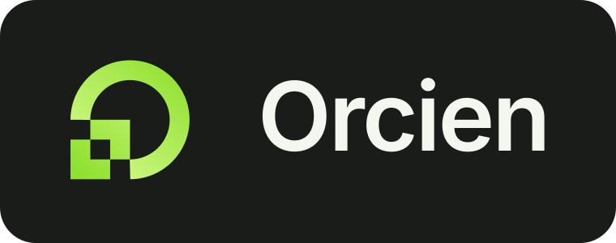
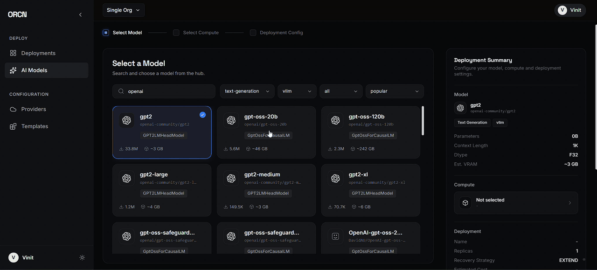
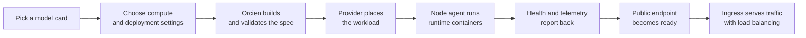
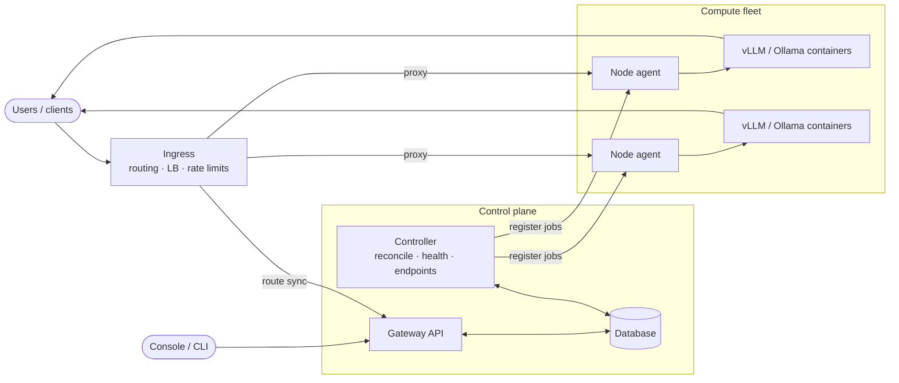
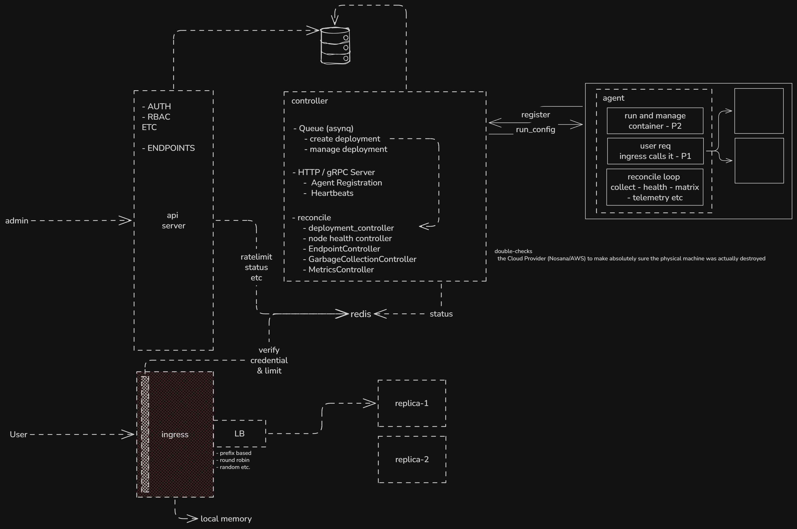

<p align="center">
  
</p>

<p align="center">
  <strong>Before the model. Beyond the request.</strong><br/>
  Provider-agnostic control plane for deploying and serving AI models on your own compute.
</p>

<p align="center">
  <a href="LICENSE"></a>
  
  
  
  
  <a href="https://github.com/openrcn/orcien/pulls"></a>
</p>

---

Orcien is an open-source inference infrastructure platform. It turns your compute — a
laptop, a homelab GPU box, a cloud GPU pool, or a decentralized network — into one
place to deploy, route, observe, and scale AI models.

You bring compute. Orcien brings the control plane.

## Demo

<p align="center">
  
</p>

<p align="center">
  <em>Pick a model card → choose compute → configure → deploy.</em>
</p>

## Why Orcien

- **One control plane, many providers.** The same model spec deploys to local Docker,
  GPU clouds, or decentralized compute.
- **Bring your own hardware.** A small node agent turns any Docker host into a
  schedulable inference node — no Kubernetes required.
- **Runtime-agnostic.** Specs are translated per runtime; vLLM and Ollama today.
- **A real ingress, not just an API.** Stable hostnames per deployment, port, and node,
  replica load balancing, admission control, and rate limits.
- **Observable by default.** Health, container events, and telemetry flow from the
  agent to the control plane.

## How it works



## Architecture



<p align="center">
  
</p>

<p align="center">
  <em>Reference architecture: API gateway, reconcile controller, ingress with load
  balancing, and node agents managing runtime containers.</em>
</p>

| Component | Role |
| --- | --- |
| **Gateway** | REST API, auth, organizations, deployments, providers, console backend |
| **Controller** | Reconcile loop: deployment status, node health, endpoints, telemetry |
| **Ingress** | Public traffic entrypoint: host routing, replica selection, admission control |
| **Node agent** | Runs on compute nodes: registers jobs, manages containers, health, events, metrics |
| **Console** | Next.js web UI for models, deployments, nodes, and providers |

## Features

| Area | What you get |
| --- | --- |
| **Deployments** | Declarative model/container specs, replicas, execution leases, restart recovery |
| **Providers** | Pluggable provider interface — local Docker and Nosana today |
| **Runtimes** | vLLM and Ollama with runtime-specific model arguments |
| **Routing** | Public ingress with per-deployment, per-port, and per-node hostnames |
| **Platform** | Organizations, secrets, registries, templates, provider connections, API keys |
| **Observability** | Health checks, container events, and per-node telemetry |

## Get started

```bash
git clone https://github.com/openrcn/orcien.git
cd orcien
make all
```

Then run the services and connect the console. Full instructions, environment
variables, and local-provider notes live in
**[Self-hosting guide →](docs/SELF_HOSTING.md)**.

## Providers & runtimes

```text
providers/
  local/     # Docker on any machine running the node agent
  nosana/    # GPU compute on the Nosana network
runtimes/
  ollama/    # Ollama model serving
  vllm/      # vLLM OpenAI-compatible serving
```

Adding a provider means implementing the provider interface (create/stop/status/health).
Routing, health, and telemetry stay in the control plane.

## Roadmap

- [ ] **GCP** provider (next cloud target)
- [ ] **Crossplane** for infrastructure provisioning (exploring)
- [ ] **Kubernetes** runtime provider with cluster autoscaling and KEDA/HPA-based
      replica scaling driven by Orcien telemetry
- [ ] **Governance** — policies, quotas, and approvals for deployments and spend
- [ ] **AI gateway** — keys, budgets, guardrails, and observability for model calls
- [ ] More runtimes (TGI, SGLang) and more decentralized compute networks

## Repository layout

```text
cmd/                # service entrypoints (gateway, controller, ingress, node-agent)
core/               # shared domain types, validation, container identity, config
models/             # persistence models (deployments, nodes, jobs, secrets, ...)
providers/          # compute provider implementations
runtimes/           # inference runtime adapters
services/           # API, controller, ingress, node-agent internals
pkg/                # routing keys, balancer, shared packages
apps/console/       # Next.js console
assets/             # brand, demo, and architecture media
docs/               # API notes, schemas, diagrams, self-hosting guide
```

## Contributing

Issues and pull requests are welcome. For larger changes, open an issue first so the
design can be discussed. Please run `go build ./... && go test ./...` before sending a
PR, and keep formatting consistent with the surrounding code.

## License

Apache-2.0 — see [LICENSE](LICENSE).
